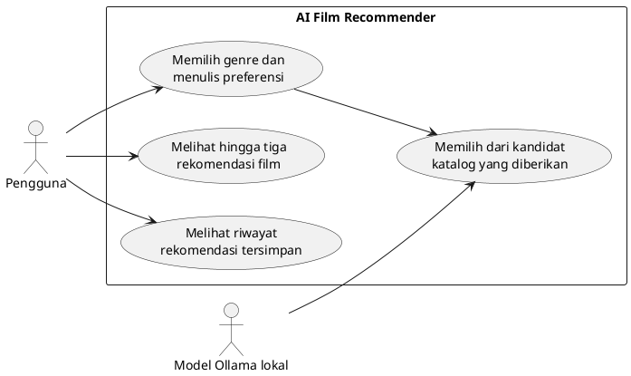
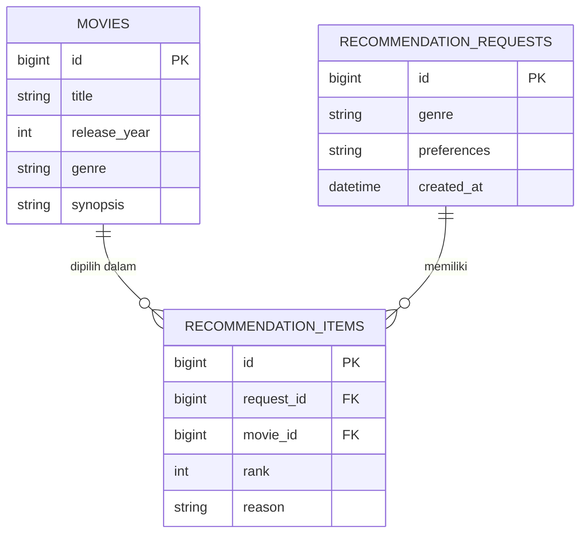

# Diagram UML dan Model Data

## Diagram use case



## Diagram kelas


## Diagram urutan rekomendasi

```mermaid
sequenceDiagram
    actor Pengguna
    participant Browser
    participant Controller as HomeController
    participant Service as MovieRecommendationService
    participant Catalog as MovieRepository
    participant Selector as MovieSelectionClient
    participant Ollama as OllamaLokal
    participant History as RecommendationRequestRepository

    Pengguna->>Browser: Memilih genre dan mengirim preferensi
    Browser->>Controller: POST /recommendations
    Controller->>Controller: Memvalidasi kolom wajib dan panjang teks
    alt Formulir tidak valid
        Controller-->>Browser: Redirect dengan pesan kesalahan
    else Formulir valid
        Controller->>Service: recommend(form)
        Service->>Catalog: Mencari kandidat sesuai genre
        alt Tidak ada kandidat
            Service-->>Controller: NO_RESULTS
        else Kandidat ditemukan
            Service->>Selector: Memilih hanya dari kandidat
            Selector->>Ollama: Meminta ID terstruktur dan alasan
            Ollama-->>Selector: Mengirim jawaban pilihan
            Selector-->>Service: MovieSelectionResponse
            Service->>Service: Memeriksa ID, keunikan, jumlah, dan alasan
            alt Pilihan valid
                Service->>History: Menyimpan permintaan dan item berperingkat
                Service-->>Controller: SUCCESS
            else Jawaban atau penyedia bermasalah
                Service-->>Controller: ERROR; tidak menyimpan data
            end
        end
        Controller-->>Browser: Redirect ke /
        Browser->>Controller: GET /
        Controller->>Catalog: Memuat daftar genre
        Controller->>History: Memuat riwayat, item, dan film
        Controller-->>Browser: Merender index.html
    end
```

## ERD logis



## Model data fisik

Hibernate membentuk skema dari entitas JPA. Saat aplikasi berjalan biasa, H2 menyimpan data dalam file dan Hibernate memakai `spring.jpa.hibernate.ddl-auto=update`. Saat tes, H2 berjalan dalam memori dengan `create-drop`.

| Tabel | Kolom | Tipe dan batasan |
| --- | --- | --- |
| `movies` | `id` | `BIGINT`, primary key yang dibuat otomatis |
|  | `title` | `VARCHAR(160) NOT NULL` |
|  | `release_year` | `INTEGER NOT NULL` |
|  | `genre` | `VARCHAR(80) NOT NULL` |
|  | `synopsis` | `VARCHAR(1200) NOT NULL` |
|  | `(title, release_year)` | Nilai gabungan harus unik |
| `recommendation_requests` | `id` | `BIGINT`, primary key yang dibuat otomatis |
|  | `genre` | `VARCHAR(80) NOT NULL` |
|  | `preferences` | `VARCHAR(300) NOT NULL` |
|  | `created_at` | `TIMESTAMP WITH TIME ZONE NOT NULL` |
| `recommendation_items` | `id` | `BIGINT`, primary key yang dibuat otomatis |
|  | `request_id` | `BIGINT NOT NULL`, foreign key ke `recommendation_requests.id` |
|  | `movie_id` | `BIGINT NOT NULL`, foreign key ke `movies.id` |
|  | `rank` | `INTEGER NOT NULL` |
|  | `reason` | `VARCHAR(500) NOT NULL` |
|  | `(request_id, rank)` | Rank harus unik untuk setiap permintaan |

Satu `RecommendationRequest` memiliki item-item rekomendasi; penghapusan permintaan ikut menghapus itemnya. Data film katalog tetap disimpan terpisah. Batas maksimal tiga pilihan dan larangan memilih film yang sama diperiksa oleh layanan aplikasi. Database memberi batas unik pada rank dalam satu permintaan, tetapi tidak memiliki batas jumlah baris item.
