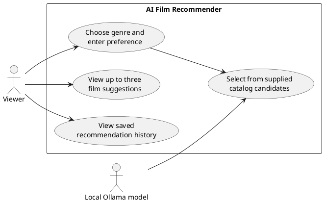
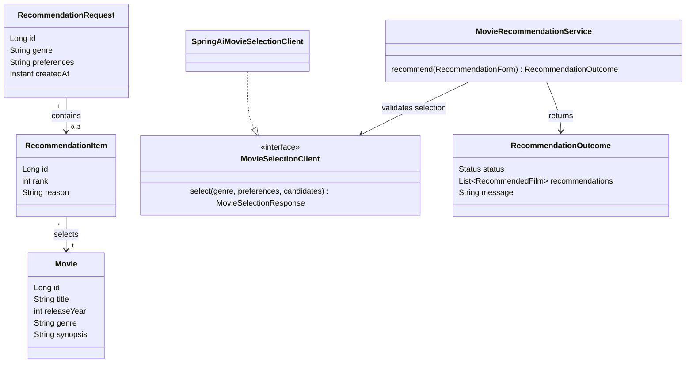
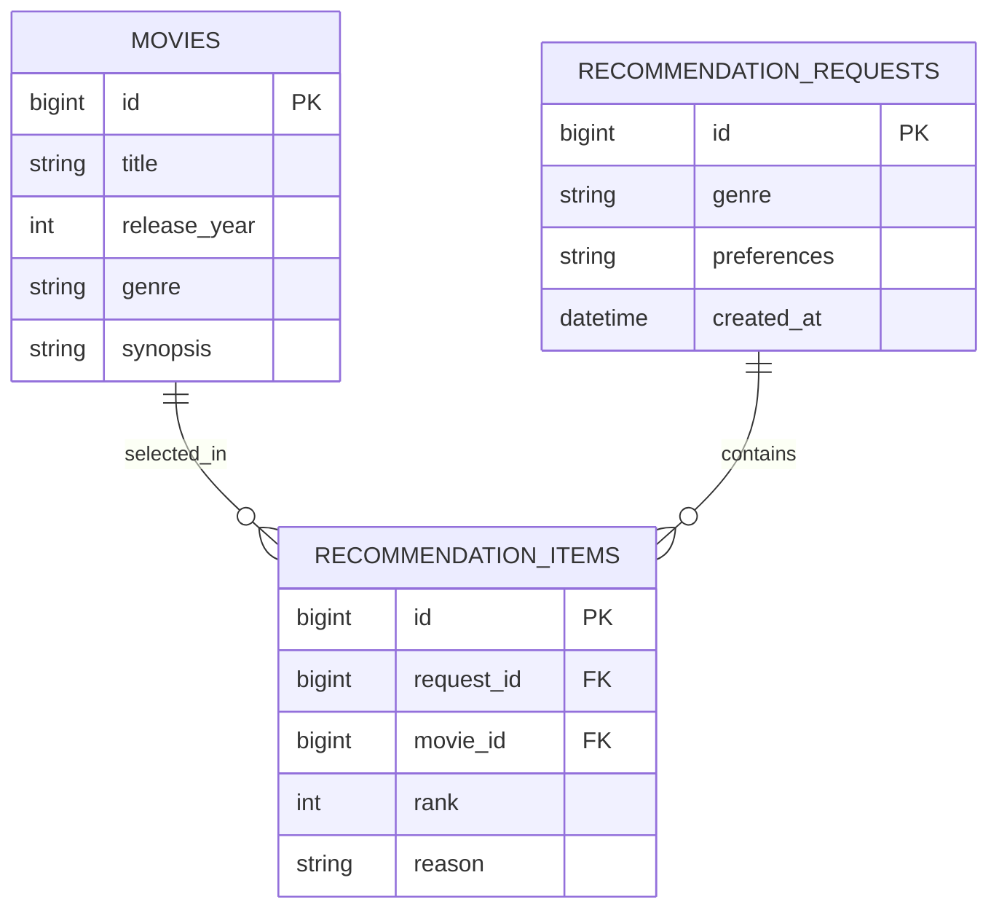

# UML and Data Model

## Use-case diagram



## Class diagram



## Recommendation sequence

```mermaid
sequenceDiagram
    actor Viewer
    participant Browser
    participant Controller as HomeController
    participant Service as MovieRecommendationService
    participant Catalog as MovieRepository
    participant Selector as MovieSelectionClient
    participant Ollama as Local Ollama
    participant History as RecommendationRequestRepository

    Viewer->>Browser: Choose genre and submit preference
    Browser->>Controller: POST /recommendations
    Controller->>Controller: Validate required fields and length
    alt Invalid form
        Controller-->>Browser: Redirect with field errors
    else Valid form
        Controller->>Service: recommend(form)
        Service->>Catalog: Find candidates for genre
        alt No candidates
            Service-->>Controller: NO_RESULTS
        else Candidates found
            Service->>Selector: Select from candidates only
            Selector->>Ollama: Structured IDs and reasons
            Ollama-->>Selector: Selection response
            Selector-->>Service: MovieSelectionResponse
            Service->>Service: Validate IDs, uniqueness, count, reasons
            alt Valid selection
                Service->>History: Save request and ranked items
                Service-->>Controller: SUCCESS
            else Invalid response or provider error
                Service-->>Controller: ERROR; save nothing
            end
        end
        Controller-->>Browser: Redirect to /
        Browser->>Controller: GET /
        Controller->>Catalog: Load distinct genres
        Controller->>History: Load history with items and movies
        Controller-->>Browser: Render index.html
    end
```

## Logical ERD



## Physical data model

The schema is managed by Hibernate from the JPA entities. Runtime uses file-backed H2 with `spring.jpa.hibernate.ddl-auto=update`; the test profile uses in-memory H2 with `create-drop`.

| Table | Column | Type / constraints |
| --- | --- | --- |
| `movies` | `id` | `BIGINT`, generated primary key |
|  | `title` | `VARCHAR(160) NOT NULL` |
|  | `release_year` | `INTEGER NOT NULL` |
|  | `genre` | `VARCHAR(80) NOT NULL` |
|  | `synopsis` | `VARCHAR(1200) NOT NULL` |
|  | `(title, release_year)` | Unique constraint |
| `recommendation_requests` | `id` | `BIGINT`, generated primary key |
|  | `genre` | `VARCHAR(80) NOT NULL` |
|  | `preferences` | `VARCHAR(300) NOT NULL` |
|  | `created_at` | `TIMESTAMP WITH TIME ZONE NOT NULL` |
| `recommendation_items` | `id` | `BIGINT`, generated primary key |
|  | `request_id` | `BIGINT NOT NULL`, FK to `recommendation_requests.id` |
|  | `movie_id` | `BIGINT NOT NULL`, FK to `movies.id` |
|  | `rank` | `INTEGER NOT NULL` |
|  | `reason` | `VARCHAR(500) NOT NULL` |
|  | `(request_id, rank)` | Unique constraint |

Each request owns its recommendation items; deleting a request cascades to its items. The movie catalog is retained independently. A per-request movie uniqueness constraint is not part of the database schema; the service enforces unique selected IDs before saving.
